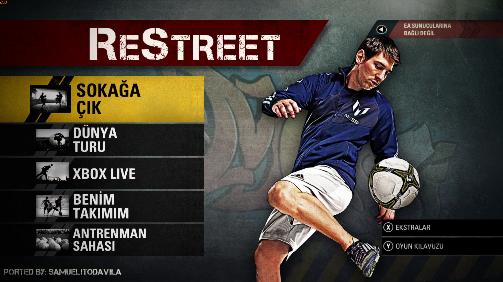
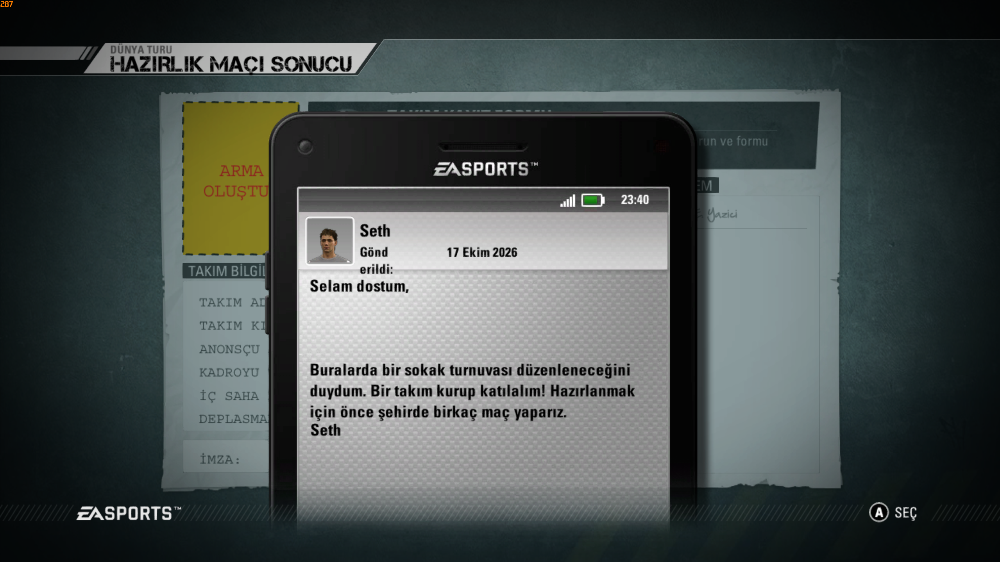

# ReStreet Süper Lig + Türkçe Yama

FIFA Street PC portuna **Galatasaray, Fenerbahçe, Beşiktaş ve Trabzonspor**, 96 oyuncu, Süper Lig menüsü ve Türkçe metinler ekler.

**Uyumlu sürüm: ReStreet 1.5.5 Online Beta · Mod sürümü: 1.0**

## İndir

**[Yamayı indir](https://github.com/ErdemYaziciOfficial/restreet-super-lig-turkce-yama/releases/latest)** → `ReStreet-SuperLig-1.0.zip` dosyasına tıkla.

> Bu bir yama paketidir. Önce [ReStreet 1.5.5 Online Beta](https://github.com/samuelit0davila/fifa-street-pc-port/releases/tag/v1.5.5-online-beta) kurulu olmalı. GitHub'ın “Source code” dosyalarını indirmene gerek yok.

## Kurulum — 5 kolay adım

1. **Oyunu ve launcher'ı kapat.**
2. İndirdiğin ZIP'e sağ tıkla → **Tümünü ayıkla**. Kurulumu ZIP'in içinden çalıştırma.
3. Çıkardığın klasörde **KUR.cmd** dosyasına çift tıkla.
4. Açılan pencerede **oyunun ana klasörünü** seç. İçinde `Binaries`, `Game` ve `FifaStreetLauncher.exe` bulunmalı. `Game` klasörünün içine girme.
5. **Kurulum tamamlandı** yazısını bekle. Launcher'ı aç, oyun dilini **English** seç ve oyna. Türkçe metinler bu dil seçeneğinde çalışır.

Program mevcut dosyaları otomatik yedekler. Kayıtlarını silmez. Python, ek program veya elle dosya kopyalama gerekmez.

## Neler var?

- Ayrı Süper Lig kategorisi ve Türkiye bayrağı/lig grafikleri.
- Galatasaray **23**, Fenerbahçe **24**, Beşiktaş **24**, Trabzonspor **25** oyuncu.
- Kadrodaki tüm oyunculara erişim ve yedekten oyuncu değişimi.
- Oyuncu yüzleri, saçlar, mini yüzler ve takım formaları.
- Menüler, açıklamalar ve Dünya Turu metinleri için Türkçe çeviri.

Kadrolar bu mod için hazırlanmıştır; birebir güncel resmî kadro iddiası taşımaz. Türkçe yama seslendirme veya video dublajı içermez. Bazı uzun metinlerde çeviri ya da satır taşması görülebilir.

## Görüntüler





**[Tanıtım videosunu izle / indir](https://github.com/ErdemYaziciOfficial/restreet-super-lig-turkce-yama/releases/download/v1.0/fifa-street-super-lig.mp4)**

## Sorun yaşarsan

- **Yanlış sürüm hatası:** Yama yalnızca belirtilen 1.5.5 sürümü içindir. Farklı sürüme zorla kurma.
- **Klasör bulunamadı:** `Binaries` ve `Game` klasörlerinin bir üstündeki oyun ana klasörünü seç.
- **Metinler İngilizce:** Launcher'daki oyun dilini **English** seçtiğinden ve yamayı doğru oyun kopyasına kurduğundan emin ol.
- **Oyuncular görünmüyor:** Takım seçiminde **Trendyol Süper Lig** kategorisine gir.
- **Sonradan portu güncelledim:** Resmî güncelleme yamanın DLL'ini değiştirebilir. Yeni sürüm için uyumluluk güncellemesini bekle.

Oyun içinde çalıştığı kullanıcı tarafından doğrulandı. Çevrimiçi maç uyumluluğu ayrıca doğrulanmadı.
Hata bildirirken oyun sürümünü, hata metnini ve mümkünse ekran görüntüsünü [Issues](https://github.com/ErdemYaziciOfficial/restreet-super-lig-turkce-yama/issues) bölümüne ekle.

## Yamayı kaldırma

Kurulumun sonunda gösterilen yedek klasörü oyunun `SuperLigBackup` klasöründedir. Paket içindeki `Restore.ps1` dosyasıyla geri alınabilir. PowerShell örneği:

```powershell
powershell -NoProfile -ExecutionPolicy Bypass -File .\Restore.ps1 -GameRoot "D:\ReStreet" -BackupFolder "D:\ReStreet\SuperLigBackup\YEDEK-KLASORU"
```

## Emeği geçenler

- Mod paketi: **Erdem Yazıcı**
- PC port: **[Samuelit0Davila / ReStreet](https://github.com/samuelit0davila/fifa-street-pc-port)** ve projenin katkıda bulunanları.
- Temel oyun: **EA SPORTS / FIFA Street**.

Bu, topluluk tarafından hazırlanmış bağımsız bir moddur; resmî EA veya ReStreet yayını değildir. Oyundaki mevcut port kredileri korunmuştur. Temel oyun, kişisel kayıtlar ve hesap bilgileri bu pakete dahil değildir.
